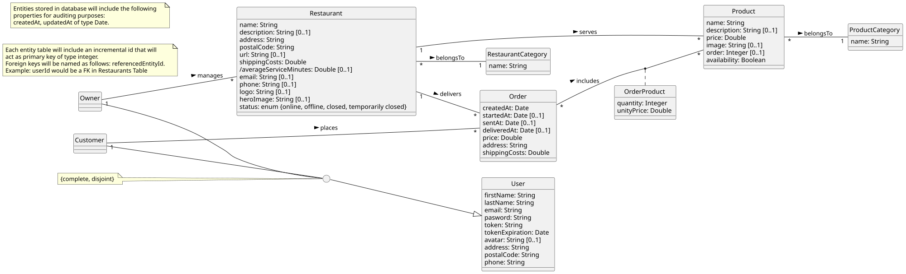
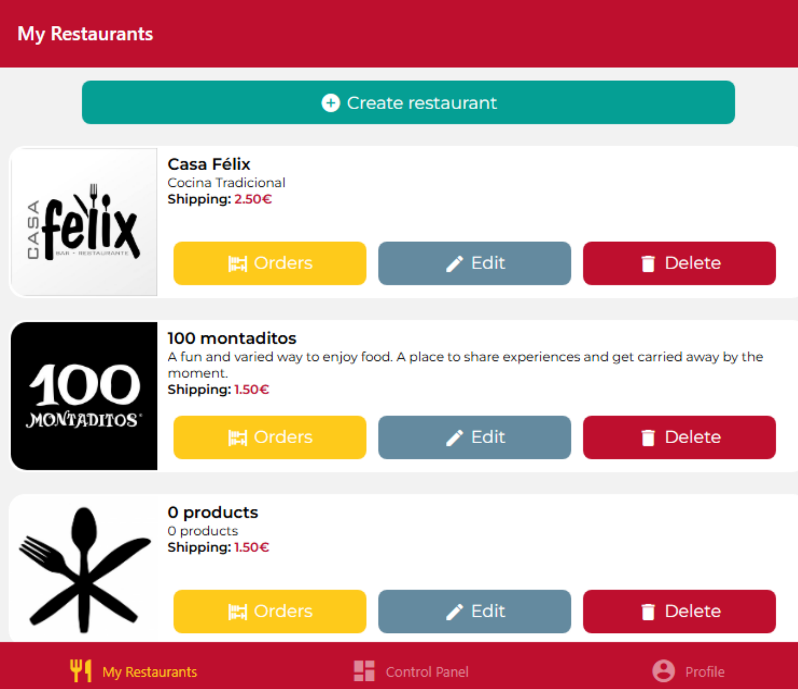
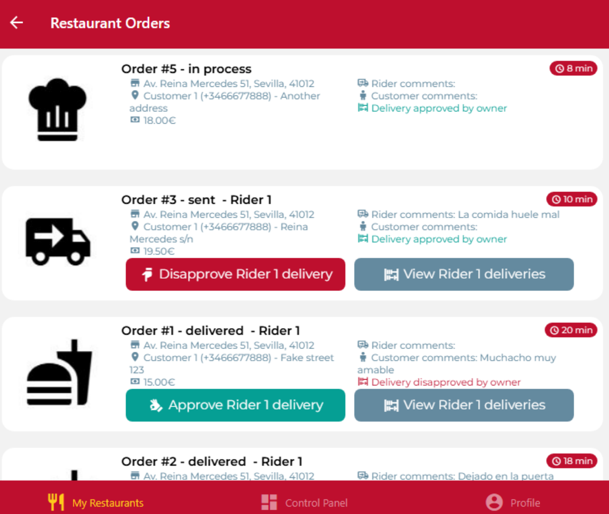
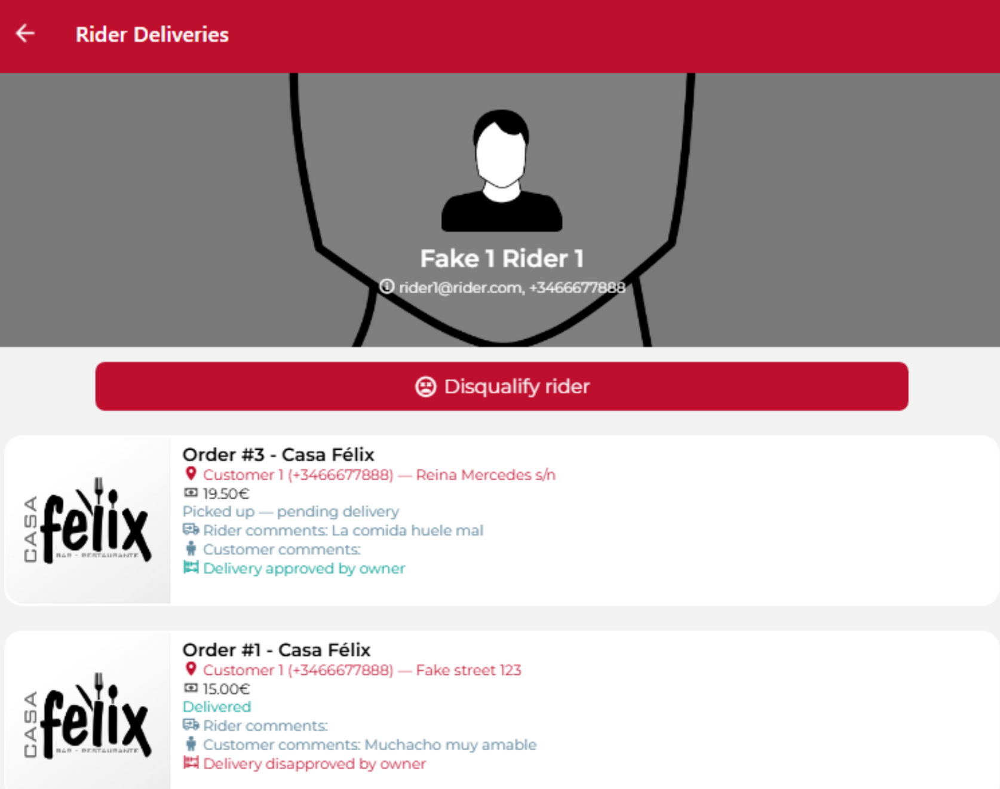
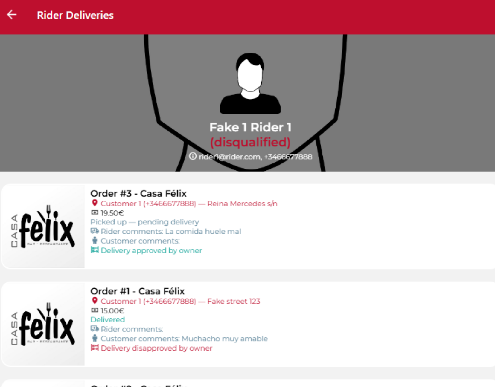
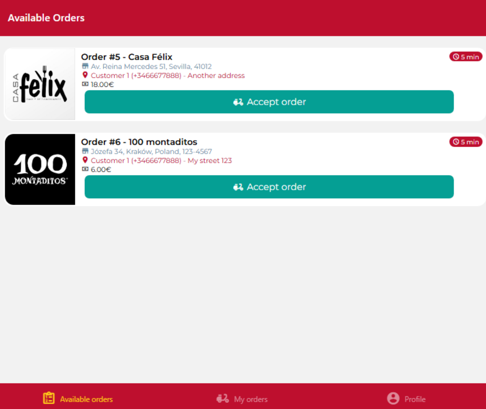
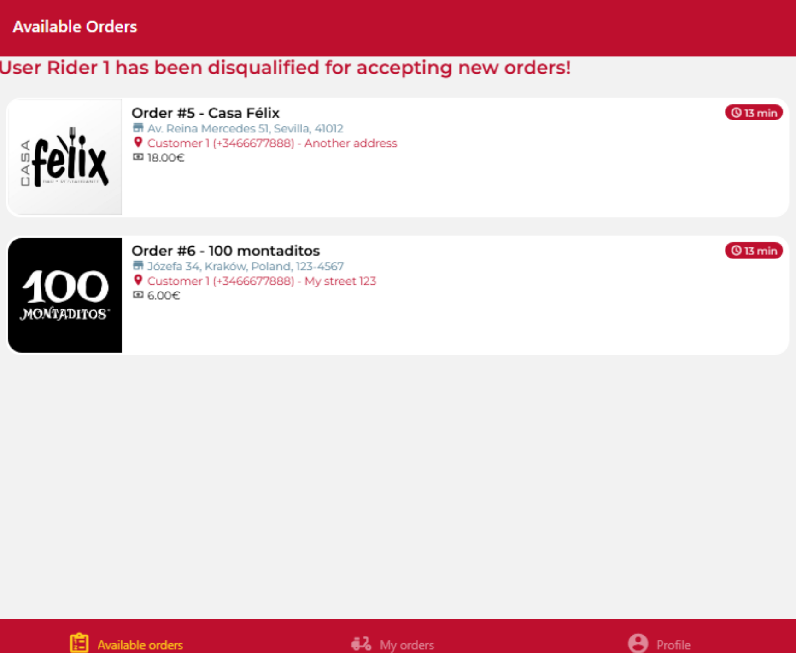
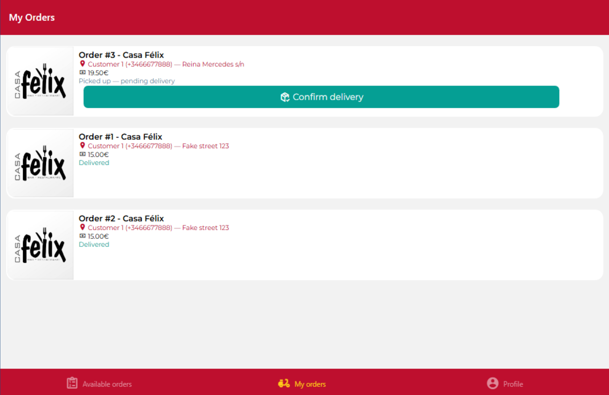
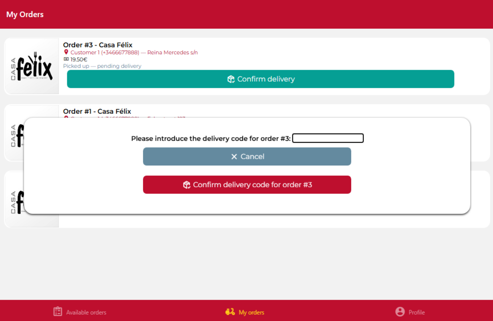

# Examen DeliverUS - Modelo Rider - Gestión de Pedidos por Repartidores vrs 2.0

## Enunciado del examen

Hasta ahora DeliverUS contaba con dos tipos de usuario: **customer** (cliente, que realiza pedidos) y **owner** (propietario, que gestiona sus restaurantes y confirma/envía/entrega los pedidos). Recientemente, se ha incorporado un **tercer tipo de usuario: `rider`** (repartidor).

### ¿Quién es el rider y qué puede hacer?

El rider es la persona que recoge en el restaurante los pedidos ya confirmados por el propietario y los entrega al cliente. Es un tipo de usuario independiente, con su propio registro, login y su propia aplicación frontend (`DeliverUS-Frontend-Rider`), igual que ya existen aplicaciones independientes para `owner` y `customer`.

De forma resumida, un rider puede: (1) **Registrarse e identificarse** como rider, (2) **Consultar los pedidos disponibles**, aquellos pedidos que el restaurante ya ha confirmado, pero que todavía no ha reclamado ningún rider, (3) **Aceptar y recoger un pedido disponible**, el rider decide encargarse de ese pedido y deja de aparecer en el listado de disponibles para el resto de riders, (4) **Entregarlo al cliente**, (5) **Añadir comentarios de reparto**, y (6) **Consultar sus propios pedidos** para hacer seguimiento de los que aún tiene pendientes de entregar y de los que ya completó.

### Modelado conceptual

Diagrama de clases de referencia de DeliverUS incluyendo las entidades y asociaciones a realizar en este examen.



### El ciclo de vida de un pedido, ampliado

El ciclo de vida de los pedidos es el siguiente: `pending → in process (startedAt) → enviado (sentAt) → entregado (deliveredAt)`, gestionado por el owner mediante `confirm`/`send`/`deliver`. Con la incorporación del rider, los pasos de envío y entrega de un pedido los puede realizar también un rider (en lugar del owner), siguiendo el siguiente diagrama de estados:


## Requisitos funcionales (tareas de los Owners)

Tras el lanzamiento de la funcionalidad del rider, **se hace necesaria la implementación de requisitos funcionales adicionales**.

> ⚠️ Las pruebas de aceptación de cada RF se dividen en **Backend** (que se pueden verificar con `riderOrders.test.js`, que no debe modificarse) y **Frontend** (comportamiento que debe observarse al usar la aplicación: navegación tras una acción y mensajes de éxito/error).

### **RF1. Consultar pedidos realizados** 

**Como** owner,

**quiero** ver la lista de pedidos asociadas a un restaurante, en especial estoy interesado en conocer el estado de cada pedido, si un rider ya ha aceptado el trabajo, junto a los comentarios que pudiera haber por parte del cliente y del propio rider,

**para** poder aprobar o no el trabajo realizado por el rider.

**Pruebas de aceptación — Backend** (`GET /restaurants/:restaurantId/orders`):

- Sin sesión iniciada: `401 Unauthorized`.
- Con sesión iniciada como `customer` o `rider`: `403 Forbidden`.
- Con sesión iniciada como `owner`: `200 OK` y un array de pedidos, ordenados según su estado: `pending` (`createdAt`), `confirmado` (`startedAt`), `enviado` (`sentAt`) y `entregado` (`deliveredAt`).
- El listado solo debe incluir pedidos cuyo `restaurantId` sea el pasado como parámetro de la url.
- Cada pedido devuelto debe incluir algunos datos del restaurante (`name`, `address`, `postalCode`), del cliente y rider (`firstName`), así como los comentarios de cliente y rider (`customerComments`, `riderComments`) y la aprobación del trabajo del rider (`ownerApprove`) por parte del propietario.

**Pruebas de aceptación — Frontend** (pantallas `RestaurantsScreen` y `OrdersScreen` de la vista del Owner:

- En la lista de restaurantes, se proporciona un botón para acceder a los pedidos asociados al restaurante. Al ser pulsado, se carga el listado de pedidos automáticamente.
- Si la petición falla, se muestra un mensaje de error y una lista de pedidos vacía.

### **RF2. Aprobar o desaprobar el trabajo de un rider para un pedido**

**Como** owner,

**quiero** alternar la aprobación del trabajo realizado por un rider para un pedido una vez que ha sido aceptado,

**para** registrar si estoy satisfecho con las entregas y conocer el desempeño de un rider.

**Pruebas de aceptación — Backend** (`PATCH /orders/:orderId/toggleApprove`):

- Sin sesión iniciada: `401 Unauthorized`.
- Con sesión iniciada como `customer` o `rider`: `403 Forbidden`.
- Pedido inexistente: `404 Not Found`.
- Pedido no pertenece al `owner`: `403 Not enough privileges`
- Pedido en estado `pending` (sin confirmar) o `confirmado`: `409 Conflict`.
- Éxito: `200 OK`; el pedido JSON devuelto tiene el valor del booleano `ownerApprove` invertido: si `true` pasa `false` y viceversa.

**Pruebas de aceptación — Frontend** (pantalla "OrdersScreen" de la vista del Owner:

- En caso de que el pedido haya sido aceptado por un rider, se muestra un botón que cambia según el trabajo del rider haya sido aprobado o no. Si lo está, se muestra el botón "Desaprobar rider". Al contrario, se muestra el botón "Aprobar rider".
- Al pulsar ese botón, ejecutar la acción y recibir respuesta 'Ok', se muestra un mensaje de éxito y se refresca el listado de pedidos, reflejando el cambio en la aprobación del trabajo del rider en ese pedido.
- Si la acción falla, se muestra un mensaje de error y la pantalla se queda sin cambios.

> ⚠️ Por defecto, `ownerApprove` es cierto, es decir, se entiende la aprobación del trabajo realizado por los riders en los pedidos que ha aceptado.

### **RF3. Consultar los pedidos aceptados por un rider** - Backend y frontend implementados

**Como** owner,

**quiero** ver el listado de los pedidos aceptados por un rider,

**para** hacer seguimiento del desempeño de un rider.

**Backend** (`GET /orders/rider/:riderId`)

**Frontend** (pantalla "RiderDeliveriesScreen" de la vista del Owner)

> ⚠️ Por motivos de brevedad, se incluyen todos los pedidos aceptados por el rider independientemente del propietario.

### **RF4. Inhabilitar un rider** - Frontend implementado

**Como** owner,

**quiero** inhabilitar un rider,

**para** evitar que siga aceptando más pedidos si su desempeño es pobre, aunque se permitirá que entregue los que ya tenga aceptados.

**Pruebas de aceptación — Backend** (`PATCH /orders/rider/:riderId/disqualify`)

- Sin sesión iniciada: `401 Unauthorized`.
- Con sesión iniciada como `customer` o `rider`: `403 Forbidden`.
- Rider inexistente: `404 Not Found`.
- Rider debe estar habilitado: `409 Conflict`.
- Rider debe tener al menos dos pedidos entregados y no aprobados en los últimos siete días: `409 Conflict`.
- Éxito: `200 OK`, de manera que el JSON con el usuario `rider` devuelto tiene la propiedad `isQualifiedRider` a falso.

**Frontend** (pantalla "RiderDeliveriesScreen" de la vista del Owner)

> ⚠️ Por defecto, se entiende que todos los riders están habilitados para aceptar pedidos cuando se registran en la aplicación.

## Requisitos funcionales (tareas de los Riders)

### **RF5. Aceptar un pedido** - implementado

**Como** owner,

**quiero** evitar que un rider inhabilitado pueda aceptar más pedidos, 

**para** no tener más comentarios negativos por parte de los clientes.

**Frontend** (pantalla "AvailableOrders" de la vista del Rider):

- Si el rider está habilitado, la pantalla sigue igual.
- Si el rider está inhabilitado, sale un mensaje de cabecera "The rider is disqualified" y no salen los botones para aceptar nuevos pedidos.

### **RF6. Confirmar una entrega con código** 

**Como** owner,

**quiero** que el rider introduzca un código al confirmar la entrega del pedido,

**para** evitar que el rider entregue el pedido al cliente equivocado.

**Pruebas de aceptación — Backend** (`PATCH /orders/:orderId/riderDeliver/:deliveryCode`):

- Sin sesión iniciada: `401 Unauthorized`.
- Con sesión iniciada como `customer` u `owner`: `403 Forbidden`.
- Pedido inexistente: `404 Not Found`.
- El código de entrega no es correcto: `409 Conflict`. Se debe chequear el campo `deliveryCode` del pedido.
- Con sesión iniciada como `rider` y código correcto: `200 OK`, de manera que el pedido pasa al estado entregado, tal y como se indica en el requisito original.

**Pruebas de aceptación — Frontend** (pantalla `MyOrdersScreen` de la vista del Rider):

- En la lista de pedidos aceptados por un Rider, se muestra un botón para confirmar la entrega de aquellos pedidos pendientes de entrega.
- Al pulsar el botón, se muestra un cuadro modal que solicita un código de entrega, junto a los botones de cancelar y confirmar la entrega.
- Si se cancela, se cierra el cuadro modal y se vuelve al listado sin cambios.
- Si se escribe el código de entrega y se da a confirmar, en caso de que la petición se ejecute con éxito, se muestra el mensaje y se vuelve a la pantalla de pedidos actualizada.
- Si la petición falla, se muestra un mensaje de error y se vuelve a la pantalla pedidos sin cambios.
- El "input" del cuadro modal siempre está vacío cuando se hace visible.

> ⚠️ El código de entrega debe habérsele proporcionado al Rider de manera previa **(esta parte del proceso no se tiene en cuenta en el presente examen)** Para poder realizar las pruebas, en la implementación actual todos los pedidos tienen `1234` como `deliveryCode`.

---

## Ejercicios del Backend

### 1. Migraciones y Modelos (1 punto)

Realice las adaptaciones necesarias en migraciones y modelos para implementar el **RF2. Aprobar o desaprobar el trabajo de un rider para un pedido**, el **RF4. Inhabilitar un rider** y el **RF6. Confirmar una entrega con un código**. 

> ⚠️ De los requisitos anteriores, los campos y asociaciones que **no** existen son: 

- En `Order`: `ownerApprove` y `deliveryCode`.
- En `User`: `isQualifiedRider`.

> ⚠️ Los seeders de la carpeta `database` ya vienen preparados para que los campos se denominen tal y como se ha indicado anteriormente. Al realizar las adaptaciones, **no** cambies estos nombres ni modifiques otros campos o asociaciones existentes.

### 2. Enrutamiento, Middlewares y Validación (2 puntos)

En `src/routes/OrderRoutes.js` añada nuevas rutas para implementar los siguientes requisitos funcionales:

- **RF2. Aprobar o desaprobar el trabajo de un rider para un pedido**
- **RF4. Inhabilitar un rider**

En `src/routes/OrderRoutes.js` adapte la ruta existente para cumplir con el requisito funcional:

- **RF6. Confirmar una entrega con un código**

En `src/middlewares/OrderMiddleware.js`, implemente los siguientes middlewares nuevos:

- `checkApprovedDeliveries` para cumplir el **RF4. Inhabilitar un rider**
- `checkDeliveryCode` para cumplir el **RF6. Confirmar una entrega con un código**

> Los middlewares `checkOrderNotPendingNotAvailable` y `checkRiderIsQualified` para cumplir  **RF2. Aprobar o desaprobar el trabajo de un rider para un pedido** y **RF4. Inhabilitar un rider**, respectivamente, ya están implementados y puedes usarlos en caso necesario.

### 3. Controladores (1,5 puntos)

En `src/controllers/OrderController.js`:

- Implemente `toggleApprove` para cumplir con **RF2. Aprobar o desaprobar el trabajo de un rider para un pedido**.
- Implemente `disqualifyRider` para cumplir con **RF4. Inhabilitar un rider**.

---

## Ejercicios del Frontend (Owner)

Adapte e implemente las pantallas necesarias en `DeliverUS-Frontend-Owner` para que un owner pueda usar las nuevas funciones de la aplicación.

**NOTA: En los ejercicios de Frontend solo se valorará aquello que pueda ser utilizado tal y como lo haría un usuario final. No se valorarán pantallas que no renderizan o funcionalidades que no puedan probarse desde la interfaz**.

### Pantalla de listado "My Restaurants" **Esta funcionalidad se proporciona**

<p align="center"></p>

**Pantalla**: `src/screens/restaurants/RestaurantsScreen.js`

Esta pantalla cumple con **RF1. Consultar pedidos realizados** e incluye el botón que permite navegar a la pantalla de pedidos de un restaurante.

### 4. Pantalla de listado "Restaurant Orders" (1,5 puntos)

<p align="center"></p>

**Pantalla**: `src/screens/restaurants/OrdersScreen.js`

Implemente esta pantalla para cumplir con **RF1. Consultar pedidos realizados**, **RF2. Aprobar o desaprobar el trabajo de un rider para un pedido** y **RF3. Consultar los pedidos aceptados por un rider**. Use el componente `ImageCard` para cada pedido. Los iconos mostrados indican el estado del pedido y están disponibles en la carpeta `assets`. Puede utilizar `RestaurantDetailScreen.js` del frontend del Owner (cabecera) y   `AvailableOrdersScreen.js` del frontend del Rider (lista de pedidos) como inspiración. Deben añadirse el botón para aprobar o desaprobar el trabajo de un rider y el botón que permita navegar a la pantalla de pedidos aceptados por un rider.

**API Backend necesaria** (añada los endpoints que considere necesarios a `src/api/RestaurantEndpoints.js`):

- `GET restaurants/:restaurantId/orders`
- `PATCH orders/:orderId/toggleApprove`

### Pantalla de listado "Rider Deliveries" **Esta funcionalidad se proporciona**

<p align="center"></p>

<p align="center"></p>

**Pantalla**: `src/screens/restaurants/RiderDeliveriesScreen.js`

Esta pantalla cumple con **RF3. Consultar los pedidos aceptados por un rider** y **RF4. Inhabilitar un rider**. 

## Ejercicios de Frontend (Rider)

Adapte las pantallas necesarias en `DeliverUS-Frontend-Rider` para que un rider pueda ver las nuevas funciones de la aplicación.

### Pantalla de listado "Available Orders" **Esta funcionalidad se proporciona**

<p align="center"></p>

<p align="center"></p>

**Pantalla**: `src/screens/availableOrders/AvailableOrdersScreen.js`

Esta pantalla cumple con **RF4. Inhabilitar un rider**.  

#### 5. Pantalla de listado "Mis Pedidos" (2,5 puntos)

<p align="center"></p>

<p align="center"></p>

**Pantalla**: `src/screens/riderOrders/MyOrdersScreen.js`

Adapte esta pantalla para cumplir con **RF6. Confirmar una entrega con un código**. Puede utilizar `RestaurantScreen.js` y `DeleteModal.js` del frontend del Owner como inspiración.

> ⚠️ En la carpeta `components` se proporciona el componente `FormModal.js` que muestra un cuadro modal que incluye una entrada de texto además de los botones habituales de cancelar y confirmar. **Este componente no puede modificarse** y requiere las siguientes propiedades:

```JSX
    <FormModal
	  infoDescriptor
	  inputValue
	  onChangeInputValue
	  isVisible
	  onCancel
	  onConfirm
	/>
```
	
Donde `infoDescriptor` es el texto que completa la etiqueta del cuadro modal, `inputValue`es la variable que recibe el valor que toma la entrada de texto, `onChangeInputValue` es la función que se llama cuando el valor de la entrada de texto cambia, `isVisible` es cierto para mostrar el cuadro modal, `onCancel`es la función que se llama para cerrar el cuadro modal y `onConfirm` es la función que se llama cuando se pulsa el botón de confirmar del cuadro modal.

> ⚠️ Alternativamente, **se podrá considerar una solución al ejercicio basada en formulario sencillo con componente Formik**, que podrá estar incluido en la propia pantalla `MyOrdersScreen.js` o ser una pantalla nueva desarrollada desde cero a criterio del estudiante e invocada desde la anterior, con la única restricción de que el diseño debe ser coherente con el estilo de la aplicación. En cualquiera de estos casos, se puntuará **1,5 puntos** como máximo al ejercicio.

**API Backend necesaria** (añada el endpoint que considere necesario de `src/api/OrderEndpoints.js`):

- `PATCH /orders/:orderId/riderDeliver/:deliveryCode`

## Ejercicios de Frontend (fidelidad estética)

### 6. Fidelidad estética (1,5 puntos)

Se valorará el **grado de similitud visual ** de las interfaces entregadas con respecto a las capturas de pantalla proporcionadas.

Para ello, tenga también en cuenta lo siguiente:

- Use los colores corporativos definidos en `src/styles/GlobalStyles.js` (`brandBlue`/`brandBlueTap`, `brandGreen`/`brandGreenTap`, `brandPrimary`) y los iconos de `MaterialCommunityIcons` (paquete `@expo/vector-icons`) ya usados en el resto de la aplicación, manteniendo un estilo consistente con las pantallas ya existentes (`AvailableOrdersScreen.js` y `RestaurantDetailScreen.js`).
- Los iconos concretos de `MaterialCommunityIcons` a utilizar son:

| Icono | Dónde |
| --- | --- |
| `abacus` | Botón "View Rider deliveries" y leyenda si el trabajo del rider está aprobado o no (Ejercicio 4). |
| `truck-delivery-outline` | Comentarios del rider (Ejercicio 4). |
| `human-child` | Comentarios del cliente (Ejercicio 4). |
| `hand-okay` | Botón "Approve delivery" (Ejercicio 4). |
| `hand-pointing-down` | Botón "Disapprove delivery" (Ejercicio 4). |
| `emoticon-dead-outline` | Botón "Disqualify rider". |
| `package-variant-closed-check` | Botón "Confirm delivery" (Ejercicio 5). |

---

### Código Proporcionado

Para este examen, se le entrega ya implementado:

1. Código que resuelve los ejercicios realizados en las clases de laboratorio en relación al usuario **owner**.
2. Código que resuelve los ejercicios del examen de segunda convocatoria en relación al nuevo usuario **rider**.
3. Código que implementa total o parcialmente algunos de los nuevos requisitos de la tercera convocatoria, tanto del usuario **owner** como **rider**.

---

## Formato de petición/respuesta

Los códigos de estado y las reglas de negocio de cada endpoint están descritos en la RF correspondiente. 

---

## Procedimiento de entrega

1. Borrar las carpetas **node_modules** de backend y ambos frontend.
2. Borrar las carpetas **.expo** de ambos frontend.
3. Crear un ZIP que incluya todo el proyecto. **Importante: Comprueba que el ZIP no es el mismo que te has descargado e incluye tu solución**
4. Avisa al profesor antes de entregar.
5. Cuando el profesor te dé el visto bueno, puedes subir el ZIP a la plataforma de Enseñanza Virtual. **Es muy importante esperar a que la plataforma te muestre un enlace al ZIP antes de pulsar el botón de enviar**. Se recomienda descargar ese ZIP para comprobar lo que se ha subido. Un vez realizada la comprobación, puedes enviar el examen.

## Preparación del entorno

### a) Windows

- Abra un terminal y ejecute el comando `npm run install:all:win`.

### b) Linux/MacOS

- Abra un terminal y ejecute el comando `npm run install:all:bash`.

## Ejecución

### 1. Backend

- Para **rehacer las migraciones y seeders**, abra un terminal y ejecute el comando

    ```Bash
    npm run migrate:backend
    ```

- Para **ejecutarlo**, abra un terminal y ejecute el comando

    ```Bash
    npm run start:backend
    ```

### 2. Frontend Owner

- Con el backend en ejecución, abra otro terminal y ejecute el comando

    ```Bash
    npm run start:frontend:owner
    ```

- Puede iniciar sesión con el usuario de pruebas `owner1@owner.com` / `secret`, o registrar un owner nuevo desde la propia aplicación.

### 3. Frontend Rider

- Con el backend en ejecución, abra otro terminal y ejecute el comando

    ```Bash
    npm run start:frontend:rider
    ```

- Puede iniciar sesión con el usuario de pruebas `rider1@rider.com` / `secret`, o registrar un rider nuevo desde la propia aplicación.

## Depuración

- Para **depurar el backend**, asegúrese de que **NO** existe una instancia en ejecución, pulse en el botón `Run and Debug` de la barra lateral, seleccione `Debug Backend` en la lista desplegable, y pulse el botón de *Play*.

- Para **depurar un frontend**, asegúrese de que **SÍ** existe una instancia en ejecución, pulse en el botón `Run and Debug` de la barra lateral, seleccione `Debug Frontend` en la lista desplegable, y pulse el botón de *Play*. 

**No se pueden depurar ambos frontends a la vez** porque la depuración está configurada para un único puerto (`8081`).  Asegúrese de que el frontend que vaya a depurar se ha desplegado primero para que ocupe dicho puerto, ya que el segundo frontend ocupará el siguiente (`8082`).

## Test

- Como ayuda puede ejecutar el conjunto de tests incluido `riderOrders.test.js`, que cubre el registro/login de riders y todo el ciclo de vida del pedido gestionado por owner (aprobar o desaprobar pedidos, inhabilitar riders) y rider (pedidos disponibles, aceptar, entregar, comentarios y listado propio). Para ello ejecute el siguiente comando:

    ```Bash
    npm run test:backend
    ```

**Advertencia: Los tests no pueden ser modificados.**
