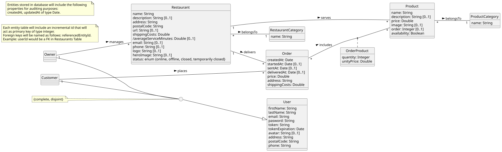
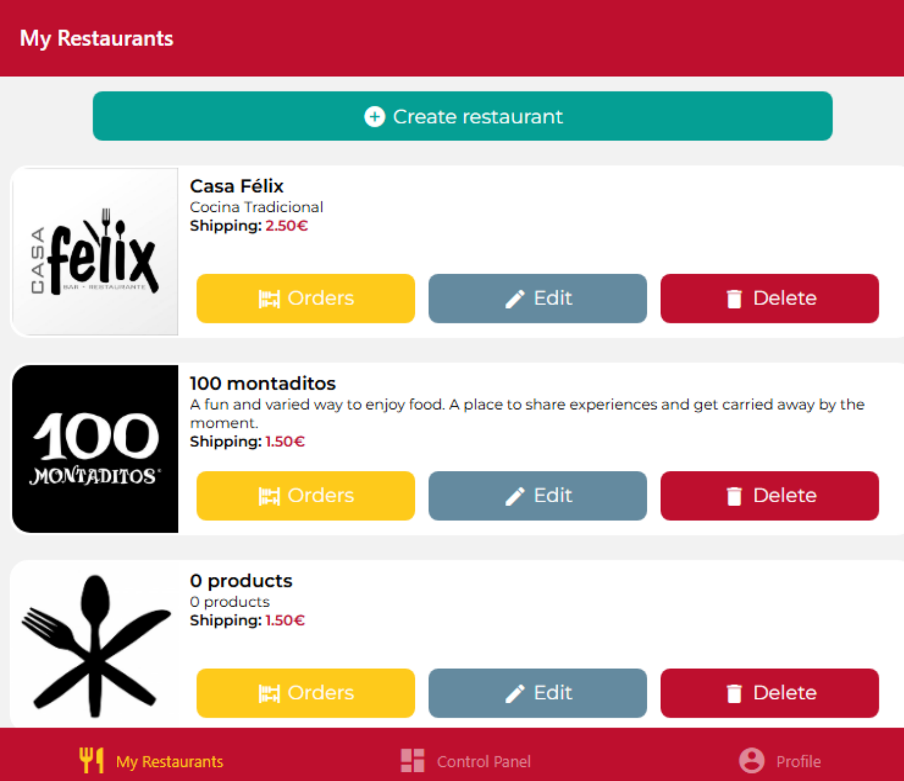
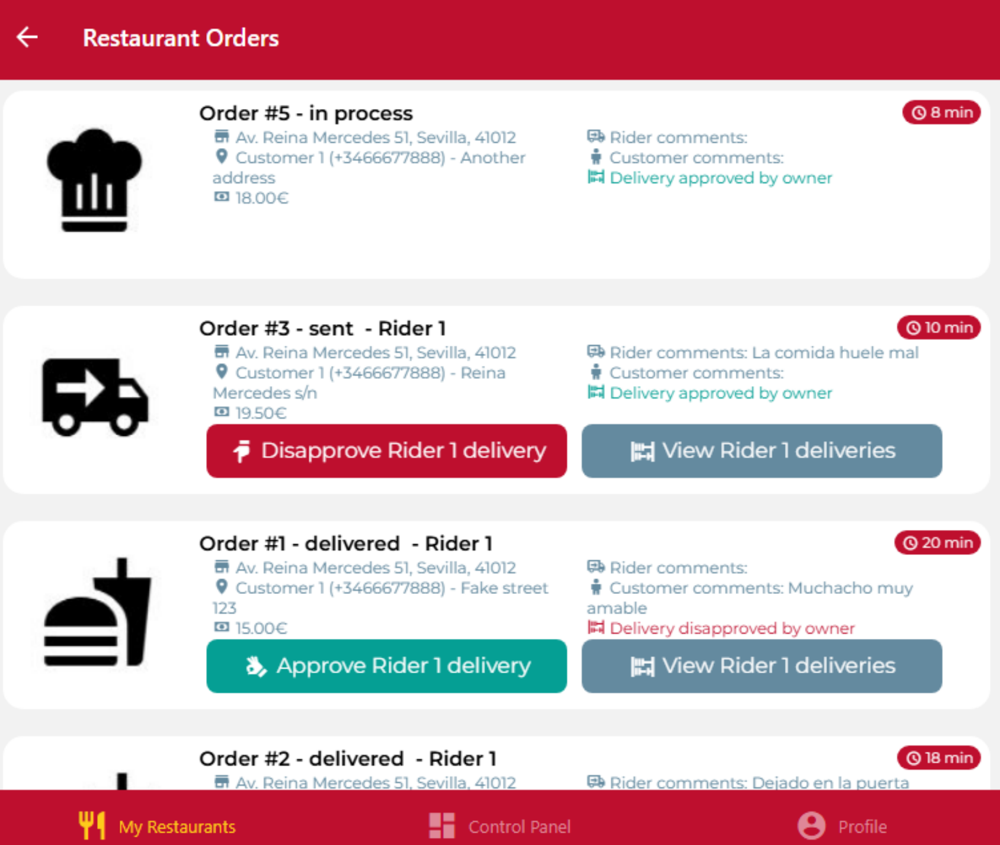
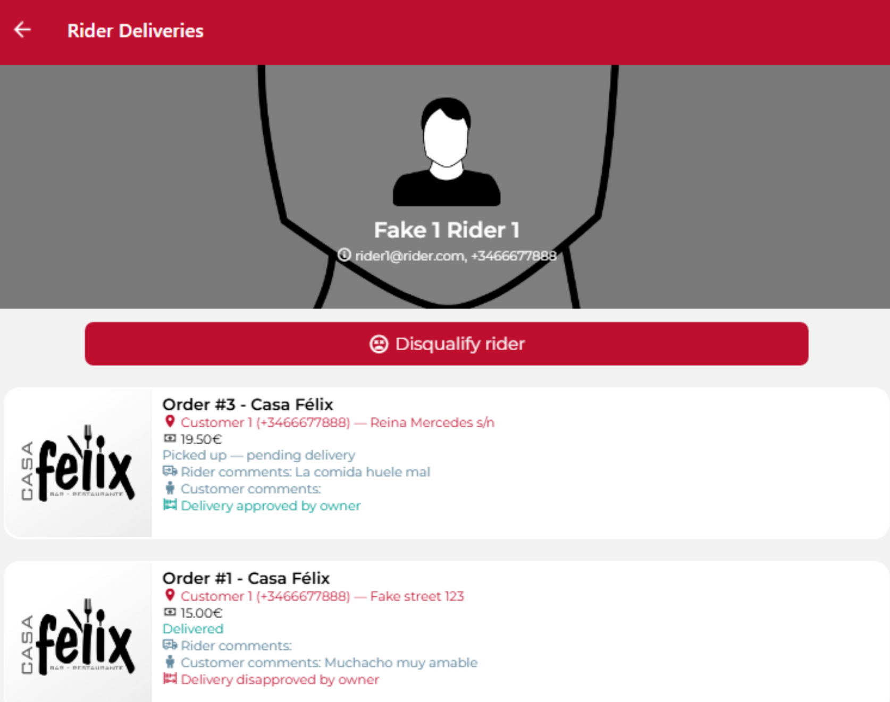
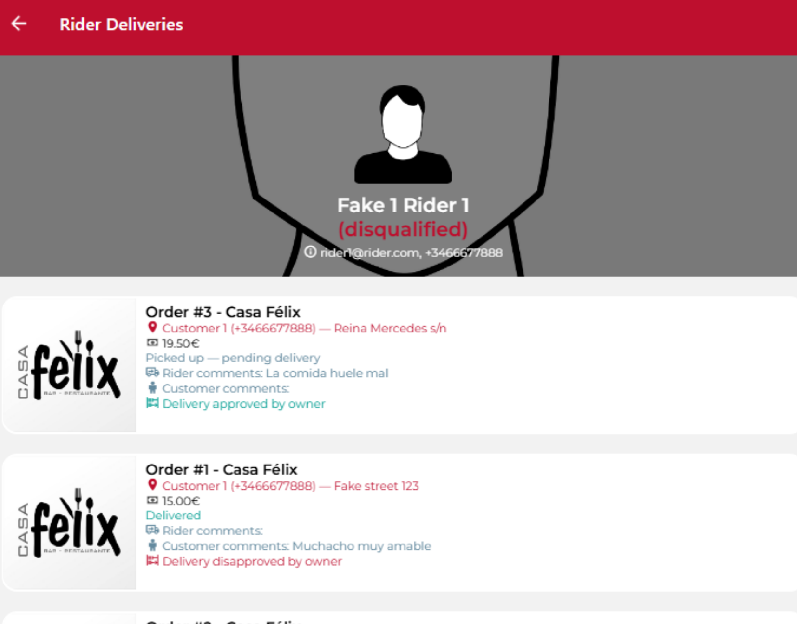
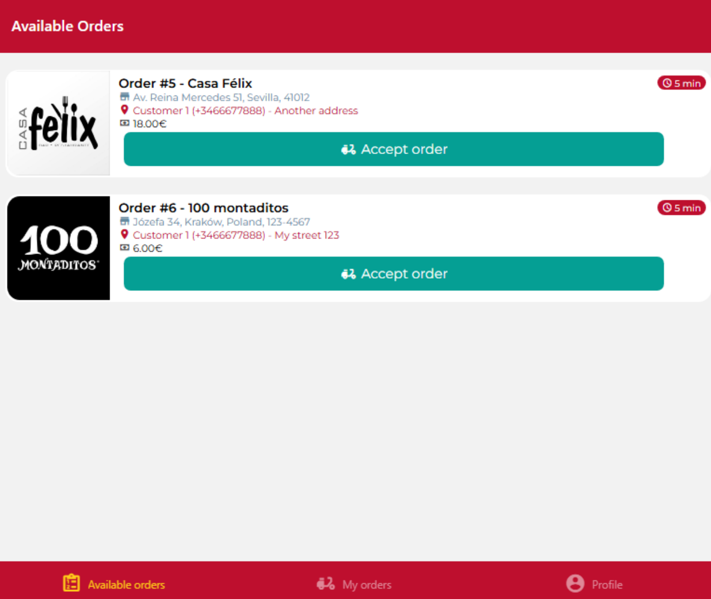
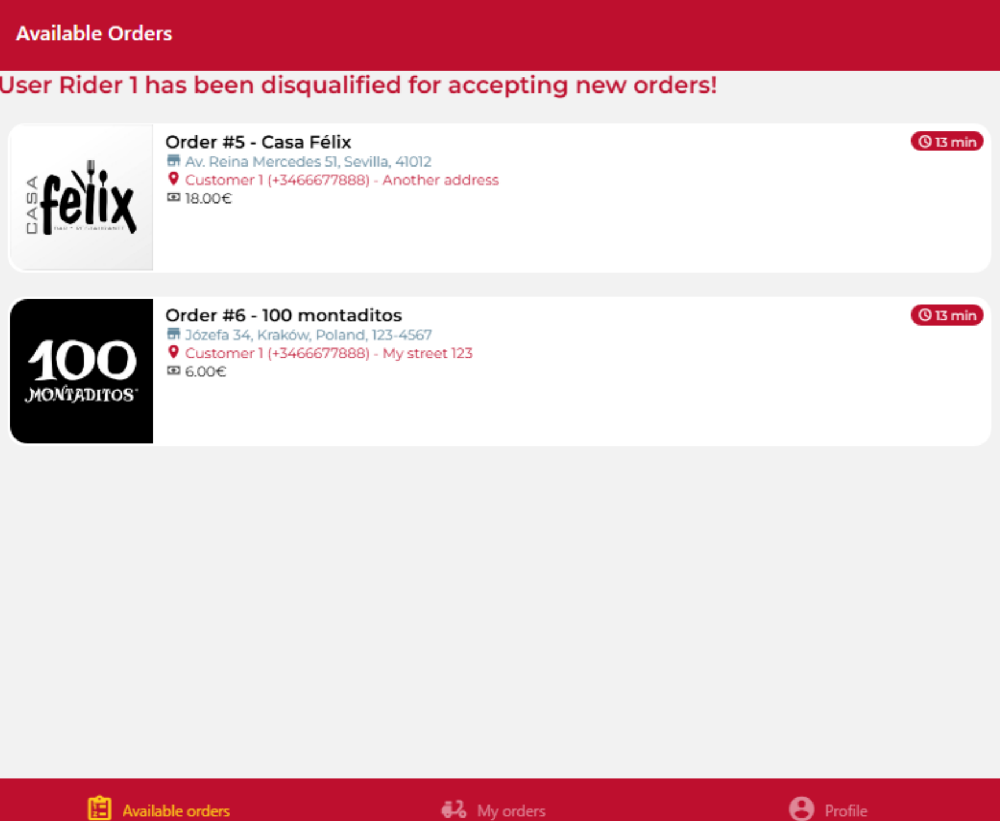
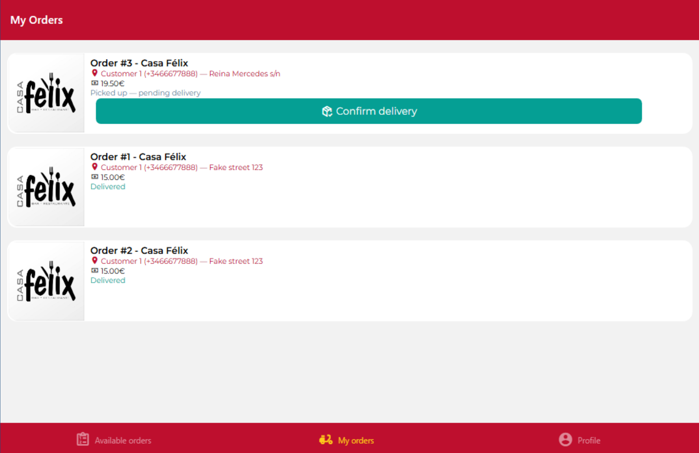
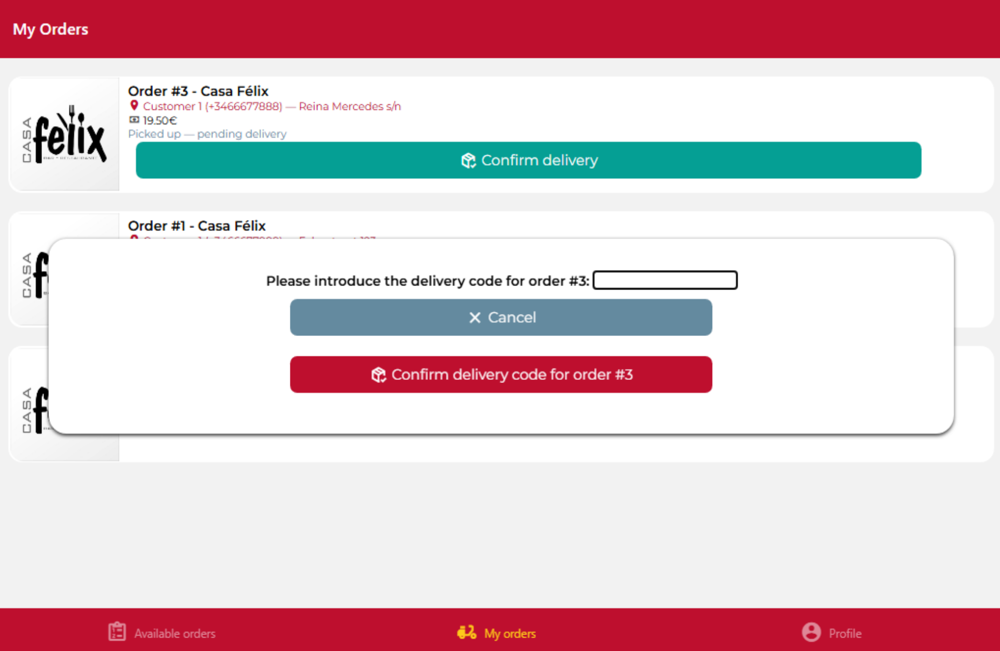

# DeliverUS Exam - Rider Model - Rider Order Management vrs 2.0

## Exam Statement

Until now DeliverUS had two user types: **customer** (client, who places orders) and **owner** (restaurant owner, who manages their restaurants and confirms/sends/delivers orders). Recently, a **third user type is added: `rider`** (delivery driver) has been incorporated.

### Who is the rider and what can they do?

The rider is the person who picks up orders already confirmed by the owner at the restaurant and delivers them to the customer. It is an independent user type, with its own registration, login, and its own frontend application (`DeliverUS-Frontend-Rider`), just like there are already separate apps for `owner` and `customer`.

In short, a rider can: (1)  **Register and login** as a rider, (2) **View available orders**, those orders that the restaurant has already confirmed but that no rider has claimed yet, (3) **Accept and pick up an available order**, the rider decides to take charge of that order, which becomes assigned to her and is marked as picked up, so that hereafter it stops appearing in the available list for other riders, (4) **Deliver it to the customer**, (5) **Add delivery comments**, and (6) **View their own orders** (the ones assigned to them) to keep track of which ones they still need to deliver and which ones are already completed.

### Conceptual modeling

DeliverUS reference class diagram, including the entities and associations to be worked on in this exam.



### The expanded order lifecycle

You already knew the lifecycle `pending → in process (startedAt) → sent (sentAt) → delivered (deliveredAt)`, managed by the owner via `confirm`/`send`/`deliver`. With the addition of the rider, the send and delivery steps of an order can also be carried out by a rider (instead of the owner), following this state diagram:


## Functional requirements (Owner tasks)

After the releasing of rider functionality, **it is necessary to implement additional requirements**. 

> ⚠️ The acceptance tests for each FR are split into **Backend** (verifiable with the help of `riderOrders.test.js`, which must not be modified) and **Frontend** (behavior that must be observed when using the application: navigation after an action and success/error messages).

### **RF1. Request the orders** 

**As** an owner,

**I want** to see the list of orders associated to a restaurant. Specifically, I am interested in the status for each order, whether a rider has accepted the order, together with comments by both riders and customers,

**so that** I can approve the work carried out by riders.

**Acceptance tests — Backend** (`GET /restaurants/:restaurantId/orders`):

- Without a session: `401 Unauthorized`.
- With a session as `customer` or `rider`: `403 Forbidden`.
- Success with a session as  `owner`: `200 OK` returning an array of orders, which is ordered according to status:: `pending` (`createdAt`) first, then `confirmed` (`startedAt`), then `sent` (`sentAt`) and finally `delivered` (`deliveredAt`).
- Such array must include only orders for the restaurant whose `restaurantId` has been passed as a parameter thorugh the URL.
- Each returned order must include: restaurant data (`name`, `address`, `postalCode`), customer and rider (`firstName`), order comments given by customer and rider  (`customerComments`, `riderComments`) and whether the work by rider is approved or not (`ownerApprove`) by the owner.

**Acceptance tests — Frontend** (`RestaurantsScreen` and `OrdersScreen` of Owner frontend):

- Each restaurant in the list is given a button for requesting the orders associated to such restaurant. On clicked, the orders are retrieved automatically.
- If the request fails, then an error message is shown and the screen remains empty.

### **RF2. Approve or disapprove the work of a rider regarding an order**

**As** an owner,

**I want** to approve or disapprove the work of a rider regarding an order, after it have been accepted,

**so that** I can known the performance of a rider.

**Acceptance tests — Backend** (`PATCH /orders/:orderId/toggleApprove`):

- Without a session: `401 Unauthorized`.
- With a session as `customer` or `rider`: `403 Forbidden`.
- Non-existent order: `404 Not Found`.
- Order not belonged to `owner`: `403 Not enough privileges`
- Order with status `pending` or `confirmed`: `409 Conflict`.
- Success with a session as `owner`: `200 OK` returning the JSON order whose boolean value for `ownerApprove` is toggled: from `true` goes to `false` and vice versa.

**Acceptance tests — Frontend** (`OrdersScreen` of Owner frontend):

- In case an order have been accepted by a rider, a button `disapprove rider` is enabled so that the owner can disapprove the work of the rider in charged of it. On the contrary, in case the owner had already disapproved the rider, then a button `approve rider` is shown insted in order to reverse the dis-approvation.
- On clicked, the toggle action is performed. On success, a message is shown and the list of orders is refreshed.
- On failing, an error message is shown and the list of orders remains unchanged.

> ⚠️ By default, `ownerApprove` is true, that is to say, the work of a rider is considered as approved for each accepted order.

### **RF3. Request orders accepted by a rider** - Backend and frontend already implemented

**As** an owner,

**I want** to see the list of orders accepted by a rider,

**so that** I can study the performance of riders.

**Backend** (`GET /orders/rider/:riderId`)

**Frontend** (`RiderDeliveriesScreen` of Owner frontend)

> ⚠️ For the sake of brevity, all accepted orders by a rider are included in the array, regardless of the owner.

### **RF4. Disqualify a rider** - Frontend already implemented

**As** an owner,

**I want** to be able to disqualify a rider,

**so that** I can avoid such rider continues to accept orders in case his/her performance is poor, but in any case, such rider will be allowed to deliver the orders which had been previously accepted.

**Acceptance tests — Backend** (`PATCH /orders/rider/:riderId/disqualify`):

- Without a session: `401 Unauthorized`.
- With a session as `customer` or `rider`: `403 Forbidden`.
- Non-existent rider: `404 Not Found`.
- Rider must be qualified: `409 Conflict`.
- Rider must have (at least) two delivered orders which had been disapproved during the last seven calendar days: `409 Conflict`.
- Success with a session as `owner`: `200 OK` returning the JSON rider whose boolean value for `isQualifiedRider` is set to false.

**Frontend** (`RiderDeliveriesScreen` of Owner frontend)

> ⚠️ By default, all riders are qualified for accepting orders once registered in the application.

## Functional requirements (Rider tasks)

### **RF5. Accepting an order** - Already implemented

**As** an owner,

**I want** to avoid a disqualified rider can accept orders, 

**so that** I do not want more negative comments by customers.

**Frontend** (`AvailableOrders` of Rider frontend):

- If the rider is qualified, the screen remains the same.
- On the contrary, the "Rider is disqualified" text is shown and acceptance buttons are not shown.

### **RF6. Confirm order delivery with a code** 

**As** an owner,

**I want** the rider have to submit a code to confirm the delivery,

**so that** I avoid deliveries to wrong customers.

**Acceptance tests — Backend** (`PATCH /orders/:orderId/riderDeliver/:deliveryCode`):

- Without a session: `401 Unauthorized`.
- With a session as `customer` or `owner`: `403 Forbidden`.
- Non-existent order: `404 Not Found`.
- Incorrect delivery code: `409 Conflict`. Note it must be checked the `deliveryCode` field order.
- Success with a session as `rider`: `200 OK` returning an order whose status is changed to delivered, as specified in the original requirement.

**Acceptance tests — Frontend** (`MyOrdersScreen` of Rider frontend):

- In the screen of orders of a rider, it is shown a button for each order in order to confirm the delivery of the order.
- On clicked, a modal is shown to request the delivery code, together with a pair of cancel and confirm buttons.
- If cancelled, it closes the modal and returns to orders list without updates.
- If the delivery code is submitted. on success a message is shown and it returns to the previous screen, updating the status of the delivered order.
- On failure, an error message is shown and it returns to the previous screen unchanged.
- The input control will be empty when the modal become visible..

> ⚠️ The delivery code must be given to the rider before the delivery **(this part of the process is not taken into account for this exam)** In order test this functionality, in the current implementation all orders are assgned `1234` as `deliveryCode`.

---

## Backend Part

### Exercises (Backend)

#### 1. Migrations and Models (1 point)

Make the necessary changes to migrations and models to implement **RF2. Approve or disapprove the work of a rider regarding an order**, **RF4. Disqualify a rider**, and **RF6. Confirm order delivery with a code**.

> ⚠️ From these requirements, the fields that do **not** exist are:

- In `Order`: `ownerApprove` and `deliveryCode`.
- In `User`: `isQualifiedRider`.

> ⚠️ Seeders in `database` folder assume fields to have a concrete name, such as specified in the requirements. In order to adapt the code, you should **not** name the fields otherwise.

#### 2. Routing, Middlewares and Validation (2 points)

In `src/routes/OrderRoutes.js` add the new routes needed to implement the following functional requirements:

- **RF2. Approve or disapprove the work of a rider regarding an order**
- **RF4. Disqualify a rider**

In `src/routes/OrderRoutes.js` adapt the existent route in order to fulfill this functional requirement:

- **RF6. Confirm order delivery with a code**

In `src/middlewares/OrderMiddleware.js`, implement the following new middlewares:

- `checkApprovedDeliveries` to fulfill **RF4. Disqualify a rider**
- `checkDeliveryCode` to fulfill **RF6. Confirm order delivery with a code**

> Middlewares `checkOrderNotPendingNotAvailable` and `checkRiderIsQualified` to fulfill **RF2. Approve or disapprove the work of a rider regarding an order** and **RF4. Disqualify a rider**, respectively, are already implemented and you may use it if needed.

#### 3. Controllers (1,5 points)

In `src/controllers/OrderController.js`:

- Implement `toggleApprove` to fulfill **RF2. Approve or disapprove the work of a rider regarding an order**.
- Implement `disqualifyRider` to fulfill **RF4. Disqualify a rider**.

---

## Frontend Exercises (Owner application)

Adapt and implement the screens in `DeliverUS-Frontend-Owner` so that an owner can use the new functionalities of the application.

**NOTE: only what can be used just as an end user would will be graded. Screens that do not render or functionality that cannot be tested from the interface will not be graded.**

### "My Restaurants" list screen **It is already implemented**

<p align="center"></p>

**Screen**: `src/screens/restaurants/RestaurantsScreen.js`

It fulfills **RF1. Request the orders** since it includes the button to navigate to the orders restaurant screen.

### 4. "Restaurant Orders" list screen (1,5 points)

<p align="center"></p>

**Screen**: `src/screens/restaurants/OrdersScreen.js`

Implement this screen to fulfill **RF1. Request the orders**, **RF2. Approve or disapprove the work of a rider regarding an order** and **RF3. Request orders accepted by a rider**. Use the `ImageCard` component for each order. Icons show the order status and they are available in the `assets` folder. You can use `RestaurantDetailScreen.js` from Owner frontend (header) and   `AvailableOrdersScreen.js` from Rider frontend (orders list) as inspiration. You must add a pair of buttons in order to (1) approve/disapprove the work of riders for an order, and (2) to navigate to the list of accepted orders of a rider.

**Required Backend API** (add the missing endpoints in  `src/api/RestaurantEndpoints.js`):

- `GET restaurants/:restaurantId/orders`
- `PATCH orders/:orderId/toggleApprove`

### "Rider Deliveries" list screen **It is already implemented**

<p align="center"></p>

<p align="center"></p>

**Screen**: `src/screens/restaurants/RiderDeliveriesScreen.js`

This screen fulfills **RF3. Request orders accepted by a rider** and **RF4. Disqualify a rider**. 

## Frontend Exercises (Rider application)

Adapt the screens needed in `DeliverUS-Frontend-Rider` so that a rider can use the new funcionalities of the application.

### "Available Orders" list screen **It is already implemented**

<p align="center"></p>

<p align="center"></p>

**Screen**: `src/screens/availableOrders/AvailableOrdesScreen.js`

This screen fulfills **RF4. Disqualify a rider**. 

### 5. "My orders" list screen (2,5 puntos)

<p align="center"></p>

<p align="center"></p>

**Screen**: `src/screens/riderOrders/MyOrdersScreen.js`

Adapt this screen to fulfill **RF6. Confirm order delivery with a code**.  You can use `RestaurantScreen.js` and `DeleteModal.js` from Owner frontend as inspiration.

> ⚠️ In `components` folder you have the `FormModal.js` component to show a modal with a text input control, together with usual cancel and confirm buttons. **This component can not be modified** and requires the next properties to be defined for using it properly:

```JSX
    <FormModal
	  infoDescriptor
	  inputValue
	  onChangeInputValue
	  isVisible
	  onCancel
	  onConfirm
	/>
```
	
where `infoDescriptor` is the text which completes the caption in the modal, `inputValue`is the variable to be assigned the input text, `onChangeInputValue` is the function to be called on input text change, `isVisible` is true if modal is to be shown, `onCancel` is the function to be called to close the modal, and `onConfirm` is the function to be called when confirm button is clicked.

> ⚠️ Alternatively, **you can consider a solution based on a Formik-based form**, which may be included either in the same `MyOrdersScreen.js` screen, or a new screen developed from scratch and invoke from such screen, according to the student criteria, with the only constraint that visual design must be coherent with the rest of applications. In any case, the exercise will be graded **1,5 points**  at most.

**Required API Backend** (adapt the endpoint as needed in `src/api/OrderEndpoints.js`):

- `PATCH /orders/:orderId/riderDeliver/:deliveryCode`

## Frontend exercises (visual fidelity)

### 6. Visual fidelity (1,5 points)

The degree of visual similarity of the delivered interfaces with respect to the provided screenshots will be evaluated.

For this, also take the following into account:

- Use the corporate colors defined in `src/styles/GlobalStyles.js` (`brandBlue`/`brandBlueTap`, `brandGreen`/`brandGreenTap`, `brandPrimary`) and the `MaterialCommunityIcons` icons (package `@expo/vector-icons`) already used in the rest of the application, keeping a style consistent with the existing screens (`AvailableOrdersScreen.js`, `OrderDetailScreen.js`).
- The specific `MaterialCommunityIcons` icons to use are:

| Icon | Where |
| --- | --- |
| `abacus` | "View Rider deliveries" button and caption if the order is approved or not (Exercise 4). |
| `truck-delivery-outline` | Rider comments (Exercise 4). |
| `human-child` | Customer comments (Exercise 4). |
| `hand-okay` | "Approve delivery" button (Exercise 5). |
| `hand-pointing-down` | "Disapprove delivery" button (Exercise 4). |
| `emoticon-dead-outline` | "Disqualify rider" button (Exercise 4). |
| `package-variant-closed-check` | "Confirm delivery" button (Exercise 5). |

---

### Provided Code

For this exam, the following is already provided implemented:

1. Code to solve the exercises from laboratory sessions during the course regarding with the **Owner** user.
2. Code to solve the exercises from Second Call exam regarding with the **Rider** user.

---

## Request/response format

The status codes and business rules for each endpoint are described in the corresponding functional requirement. 

---

## Submission procedure

1. Delete the **node_modules** folders from the backend and both frontends, and **.expo** folders from both frontends.
2. Create a ZIP including the whole project. **Important: Check that the ZIP is not the same one you downloaded and that it includes your solution.**
3. Notify the instructor before submitting.
4. When the instructor gives you the go-ahead, you can upload the ZIP to the Virtual Learning platform. **It is very important to wait for the platform to show you a link to the ZIP before pressing the submit button**. It is recommended to download that ZIP to check what has been uploaded. Once you have checked it, you can submit the exam.

## Environment setup

### a) Windows

- Open a terminal and run the command `npm run install:all:win`.

### b) Linux/MacOS

- Open a terminal and run the command `npm run install:all:bash`.

## Running

### 1. Backend

- To **redo the migrations and seeders**, open a terminal and run the command

    ```Bash
    npm run migrate:backend
    ```

- To **run it**, open a terminal and run the command

    ```Bash
    npm run start:backend
    ```

### 2. Owner Frontend

- With the backend running, open another terminal and run the command

    ```Bash
    npm run start:frontend:owner
    ```

- You can log in with the test user `owner1@owner.com` / `secret`, or register a new owner from the app itself.

### 3. Rider Frontend

- With the backend running, open another terminal and run the command

    ```Bash
    npm run start:frontend:rider
    ```

- You can log in with the test user `rider1@rider.com` / `secret`, or register a new rider from the app itself.

## Debugging

- To **debug the backend**, make sure there is **NO** instance already running, click the `Run and Debug` button in the sidebar, select `Debug Backend` from the dropdown list, and press the *Play* button.

- To **debug the frontend**, make sure **THERE IS** an already running instance, click the `Run and Debug` button in the sidebar, select `Debug Frontend` from the dropdown list, and press the *Play* button. 

**You can not debug both frontends at the same time** because debugging is set at `8081` port. Make sure the frontend to debug is deployed at first, so that it get such port. The frontend deployed in second place will get the `8082` port instead.

## Test

- As a help, you can run the included test suite `riderOrders.test.js`, which covers rider registration/login and the whole order lifecycle managed by the owner (approve or disapprove orders, and disqualify riders) and the rider (available orders, accept, deliver, comments and own listing). To do so, run the following command:

    ```Bash
    npm run test:backend
    ```

**Warning: Tests must not be modified.**
